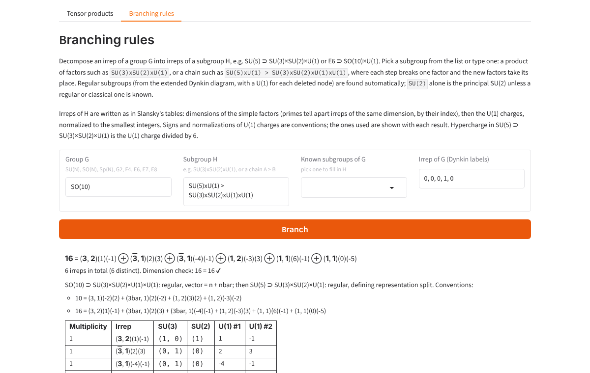

# lie-tensor-products

Compute the Clebsch-Gordan decomposition of tensor products of irreducible representations of simple Lie algebras:
SU(N) with Young tableaux, and SO(N), Sp(2N), G2, F4, E6, E7, E8 (as well as SU(N)) with weights. Also computes branching
rules: how an irrep of G splits into irreps of a subgroup H, e.g. SU(5) ⊃ SU(3)×SU(2)×U(1) or E6 ⊃ SO(10)×U(1).

The algorithm is the one described in Howard Georgi's book *Lie Algebras in Particle Physics*: the boxes of the second
Young diagram are labelled a, b, c, ... by row and added to the first diagram, keeping only the tableaux that pass
Georgi's checks. For SU(N) this is the Littlewood-Richardson rule.


## Files

| File | What it does |
| --- | --- |
| `su3_irrep_CG.py` | The original SU(3) implementation (`Irrep(n, m)`, `multiply_irreps`) |
| `sun_irrep_CG.py` | The SU(N) generalization for any N >= 2 (`IrrepSUN`, `decompose`, `decompose_many`) |
| `lie_algebra_CG.py` | Any simple Lie algebra, using weights (`LieIrrep`, `lie_algebra`, `decompose`, `decompose_many`) |
| `branching.py` | Branching rules for subgroups, with U(1) charges (`embedding`, `branch`, `format_branching`) |
| `app.py` | Gradio web app: products of 2 to 4 irreps, and branching rules |
| `front_end_1.py` | Command-line prompt for SU(3) |
| `write_irrep_to_file.py` | Reads SU(3) cases from `test_cases.csv`, writes `result.txt` |
| `tests/` | pytest suite |

## Usage

```python
from sun_irrep_CG import IrrepSUN, decompose, format_product

octet = IrrepSUN(3, (1, 1))           # SU(3), Dynkin labels (1, 1)
terms = decompose(octet, octet)       # [(irrep, multiplicity), ...], largest first
print(format_product([octet, octet], terms))
# (1, 1)[8] ⊗ (1, 1)[8] = (2, 2)[27] ⊕ (3, 0)[10] ⊕ (0, 3)[10 bar] ⊕ 2 (1, 1)[8] ⊕ (0, 0)[1]

IrrepSUN.from_partition(5, (1, 1))     # build from Young diagram row lengths: the 10 of SU(5)
```

For other algebras, `lie_algebra_CG.py` has the same interface. Algebras are named `SU(N)`, `SO(N)`, `Sp(N)` (N even),
`G2`, `F4`, `E6`, `E7`, `E8`, or by Cartan type (`A3`, `B4`, `C2`, `D5`, ...), and Dynkin labels follow Bourbaki's
numbering of the simple roots:

```python
from lie_algebra_CG import LieIrrep, decompose, format_product

spinor = LieIrrep('SO(10)', (0, 0, 0, 1, 0))
print(format_product([spinor, spinor], decompose(spinor, spinor)))
# (0, 0, 0, 1, 0)[16] ⊗ (0, 0, 0, 1, 0)[16] = (0, 0, 0, 2, 0)[126] ⊕ (0, 0, 1, 0, 0)[120] ⊕ (1, 0, 0, 0, 0)[10]
```

It finds the weights of an irrep and their multiplicities with Freudenthal's formula, then decomposes the product
with the Racah-Speiser algorithm: each weight of the smaller factor is added to the highest weight of the other plus
rho, and the result is reflected into the dominant Weyl chamber, with a sign for each reflection.

An irrep is written `(Dynkin labels)[dimension]`, with `bar` when its labels are lexicographically smaller than those
of its conjugate irrep. For SU(N) the conjugate has the labels reversed, so (n, m) is barred when n < m, as in the
original SU(3) code.

## Branching rules

```python
from branching import embedding, branch, format_branching, describe
from lie_algebra_CG import LieIrrep

e = embedding('SO(10)', 'SU(5)xU(1)')
sixteen = LieIrrep('SO(10)', (0, 0, 0, 1, 0))
print(format_branching(sixteen, branch(sixteen, e)))
# 16 = 10(-1) + 5bar(3) + 1(-5)

e = embedding('E6', 'SO(10)xU(1) > SU(5)xU(1)xU(1)')   # a chain: each step breaks one factor
print(describe(e, 1))
# ['27 = 10(-1)(1) + 5(2)(-2) + 5bar(3)(1) + 5bar(-2)(-2) + 1(0)(4) + 1(-5)(1)']
```

`branch` returns a list of `(SubIrrep, multiplicity)`; a `SubIrrep` holds a `LieIrrep` for each simple factor and a
charge for each U(1). Irreps of H are written as in Slansky's tables (Phys. Rept. 79 (1981) 1): the dimensions of the
simple factors, then the U(1) charges. Irreps of the same dimension get primes in order of their index (15 and 15' of
SU(3), 8, 8' and 8'' of SO(8)), and `bar` as above.

An embedding is its projection matrix, a linear map from the weights of G to the weights of H. To branch an irrep, its
weights are projected and the irreps of H are peeled off from the highest projected weight down. The matrices are not
copied from tables; they are built from the embeddings:

- regular subgroups, from roots of G: deleting a node of the extended Dynkin diagram gives the maximal ones
  (Borel-de Siebenthal), deleting nodes of the ordinary diagram gives a U(1) for each deleted node. Any regular subgroup
  of this kind is found from its name, e.g. `E8 > SO(14)xU(1)` or `E7 > SO(10)xSU(2)xU(1)`;
- subgroups of SU(N), SO(N) and Sp(N), from how the defining representation splits: SU(p)×SU(q)×U(1), SO(p)×SO(q),
  SU(n)×U(1) in SO(2n) and Sp(2n), Sp(2p)×Sp(2q), and the special SO(N) and Sp(N) in SU(N), SU(p)×SU(q) in SU(pq),
  SO(p)×SO(q) in SO(pq), Sp×Sp in SO, Sp×SO in Sp, G2 in SO(7);
- the principal SU(2) of any group (`SU(2)`, when no regular or classical one is known);
- the special maximal subgroups of the exceptional groups: E6 ⊃ F4, Sp(8), G2, SU(3)×G2; E7 ⊃ SU(2)×F4, G2×Sp(6);
  E8 ⊃ G2×F4; F4 ⊃ SU(2)×G2. Each is lifted from a subgroup K of the same rank as H that is known in G (e.g. for E6 ⊃
  F4, K = SO(9) from E6 ⊃ SO(10) ⊃ SO(9)): the projection to H is the inverse of H ⊃ K applied after G ⊃ K.

Not included: the special SU(3) of E6 and E7, SU(2)×G2 and the other special SU(2)s of E7, and SU(2)×SU(3) and Sp(4)
of E8.

The U(1) charges are scaled to the smallest integers, and their signs follow Slansky for the usual GUT embeddings: the
U(1) of SU(5) ⊃ SU(3)×SU(2)×U(1) is 6 times the hypercharge (5 = (3, 1)(-2) + (1, 2)(3)), the 16 of SO(10) is
10(-1) + 5bar(3) + 1(-5) and the 27 of E6 is 16(1) + 10(-2) + 1(4).

`tests/test_branching.py` checks every embedding: dimensions add up; the projected weights of each irrep are exactly the
weights of the irreps it branches into (which fails for a projection that does not come from a real embedding);
conjugate irreps branch to conjugates; the adjoint of G contains the adjoint of each factor of H; the index sum rule;
branching commutes with tensor products (decomposed with `lie_algebra_CG.py` on both sides); the embedding indices of
the special subgroups agree with Dynkin's tables (e.g. 3 for E6 ⊃ G2, (3, 1) for E7 ⊃ SU(2)×F4, 1240 for the principal
SU(2) of E8); the adjoint under the principal SU(2) splits into spins given by the exponents; the extended Dynkin
diagrams give the Borel-de Siebenthal subgroups; and about 70 branchings agree with Slansky's tables.



## Web app

```
pip install -r requirements.txt
python app.py
```

then open http://127.0.0.1:7860. The "Branching rules" tab takes a group, a subgroup (typed, or picked from the known
subgroups of the group) and an irrep. `app.py` and `requirements.txt` can also be uploaded as they are to a Hugging Face
Space (Gradio SDK).

## Tests

```
pip install pytest gradio
python -m pytest
```

The tests check known decompositions (SU(2) angular momentum, SU(3), SU(4), SU(5) tables), that dimensions add up,
commutativity, associativity and conjugation symmetry, that the original SU(3) code and the SU(N) code agree, and,
independently of the Young tableau method, that the characters (weights counted from semistandard tableaux) of each
product equal the characters of its decomposition.

For the other algebras they check the root systems and Cartan matrices, the dimensions of all fundamental irreps,
known products (SO(7), SO(8), SO(9), SO(10), Sp(4), Sp(6), G2, F4, E6, E7, E8), that the weight method agrees with
the Young tableau code for SU(N), the isomorphisms SO(5) = Sp(4) and SO(6) = SU(4), that weight multiplicities add up
to the Weyl dimension, and the same character, dimension, symmetry and singlet checks as for SU(N).
