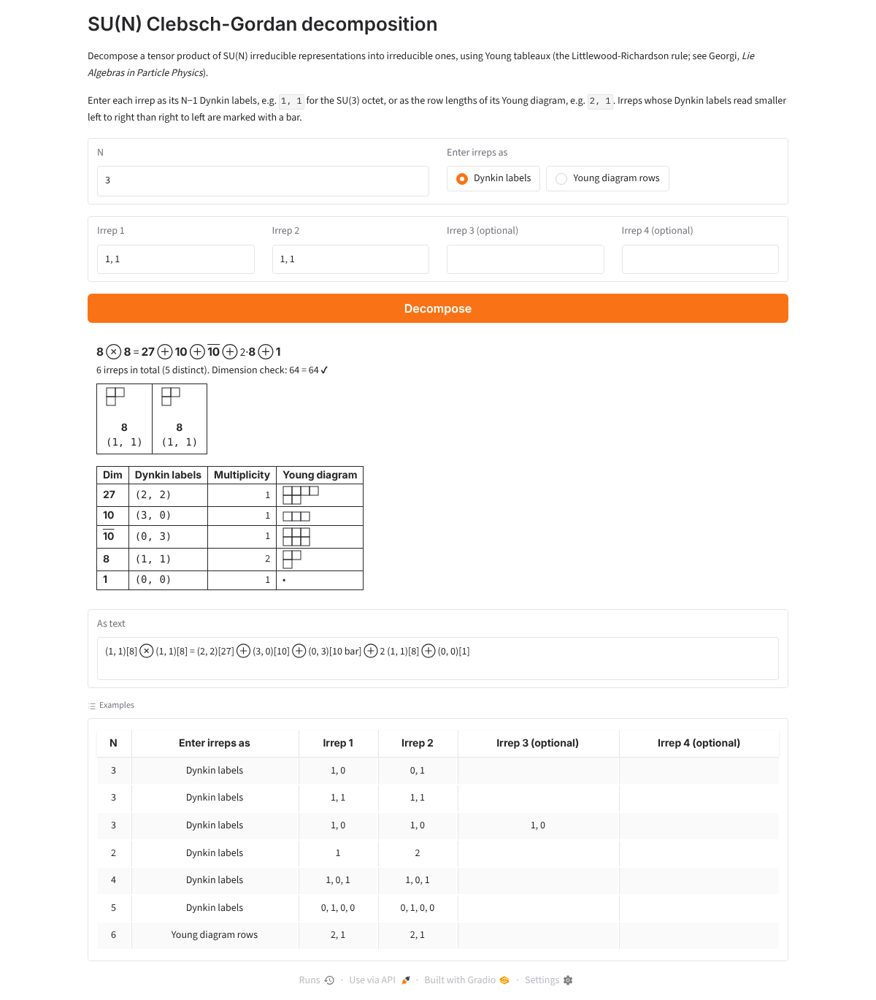

# su_irreps

Compute the Clebsch-Gordan decomposition of tensor products of SU(N) irreducible representations using Young tableaux.

The algorithm is the one described in Howard Georgi's book *Lie Algebras in Particle Physics*: the boxes of the second
Young diagram are labelled a, b, c, ... by row and added to the first diagram, keeping only the tableaux that pass
Georgi's checks. For SU(N) this is the Littlewood-Richardson rule.



## Files

| File | What it does |
| --- | --- |
| `su3_irrep_CG.py` | The original SU(3) implementation (`Irrep(n, m)`, `multiply_irreps`) |
| `sun_irrep_CG.py` | The SU(N) generalization for any N >= 2 (`IrrepSUN`, `decompose`, `decompose_many`) |
| `app.py` | Gradio web app for SU(N) products of 2 to 4 irreps |
| `front_end_1.py` | Command-line prompt for SU(3) |
| `write_irrep_to_file.py` | Reads SU(3) cases from `test_cases.csv`, writes `result.txt` |
| `tests/` | pytest suite |

## Usage

```python
from sun_irrep_CG import IrrepSUN, decompose, format_product

octet = IrrepSUN(3, (1, 1))           # SU(3), Dynkin labels (1, 1)
terms = decompose(octet, octet)       # [(irrep, multiplicity), ...], largest first
print(format_product([octet, octet], terms))
# (1, 1)[8] ⊗ (1, 1)[8] = (2, 2)[27] ⊕ (3, 0)[10] ⊕ (0, 3)[10 bar] ⊕ 2 (1, 1)[8] ⊕ (0, 0)[1]

IrrepSUN.from_partition(5, (1, 1))     # build from Young diagram row lengths: the 10 of SU(5)
```

An irrep is written `(Dynkin labels)[dimension]`, with `bar` when its labels read smaller left to right than right to
left, so (n, m) is barred when n < m, as in the original SU(3) code.

## Web app

```
pip install -r requirements.txt
python app.py
```

then open http://127.0.0.1:7860. `app.py` and `requirements.txt` can also be uploaded as they are to a Hugging Face
Space (Gradio SDK).

## Tests

```
pip install pytest gradio
python -m pytest
```

The tests check known decompositions (SU(2) angular momentum, SU(3), SU(4), SU(5) tables), that dimensions add up,
commutativity, associativity and conjugation symmetry, that the original SU(3) code and the SU(N) code agree, and,
independently of the Young tableau method, that the characters (weights counted from semistandard tableaux) of each
product equal the characters of its decomposition.
